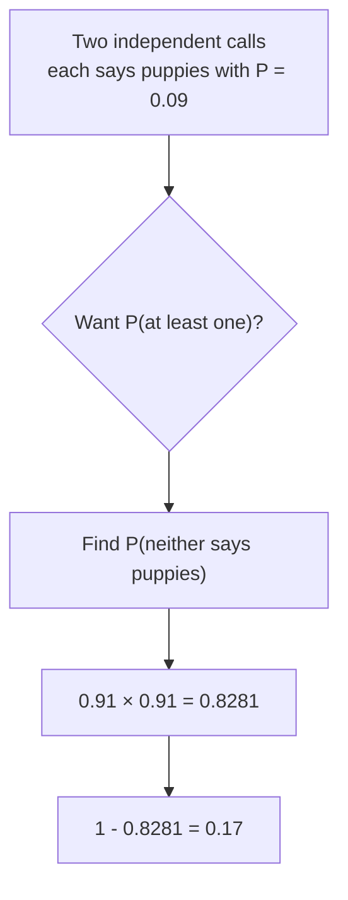
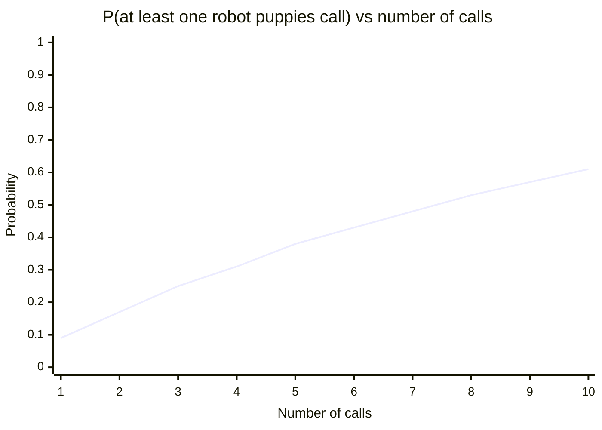
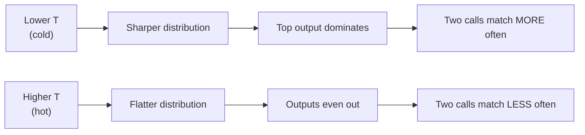
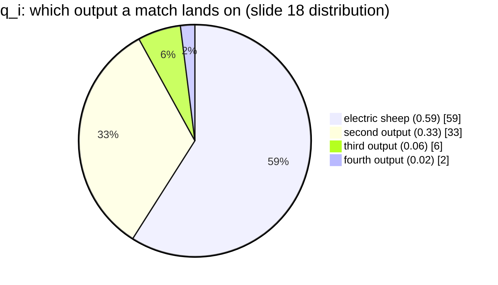

# Probability for AI: Week 1 Additional Problems
### Repeated Calls, the Complement Rule, and Temperature Effects

---

## Table of Contents

0. [Where We Are and What You Need](#0-where-we-are-and-what-you-need)
1. [Setting the Scene: Slides 10–14 in One Paragraph](#1-setting-the-scene-slides-1014-in-one-paragraph)
2. [Problem A: Two Calls, At Least One Says "Robot Puppies" (Slide 15)](#2-problem-a-two-calls-at-least-one-says-robot-puppies-slide-15)
3. [Problem B: How Many Calls Until the Chance Passes 50%? (Slide 16)](#3-problem-b-how-many-calls-until-the-chance-passes-50-slide-16)
4. [Problem C: What Does Temperature Do to Matching Answers? (Slide 17)](#4-problem-c-what-does-temperature-do-to-matching-answers-slide-17)
5. [Problem D: Which Output Is Most Likely Given a Match? (Slide 18)](#5-problem-d-which-output-is-most-likely-given-a-match-slide-18)
6. [Extra Practice Problems (With Solutions)](#6-extra-practice-problems-with-solutions)
7. [Common Mistakes in This Section](#7-common-mistakes-in-this-section)
8. [Quick Reference Sheet](#8-quick-reference-sheet)

---

## 0. Where We Are and What You Need

You need these tools from the main Week 1 notes:

| Tool | Usecase | Formula |
|---|---|---|
| Complement rule | "At least one" problems | $P(E^C) = 1 - P(E)$ |
| Independence | Repeated calls to the same model | $P(A \text{ and } B) = P(A) \cdot P(B)$ |
| Powers | Repeating a probability $n$ times | $0.91^n = \underbrace{0.91 \times \cdots \times 0.91}_{n}$ |
| Summation | Adding up squared probabilities | $\sum_i p_i^2$ |
| Conditional probability | "Given that the two calls match" | $P(B \mid A) = \frac{P(A \text{ and } B)}{P(A)}$ |

> **NOTE:** Slides 15–18 use the probability that the robot puppies output appears, which is **0.09**. This comes from the table on slide 12, which lists five possible outputs of the toy LLM with probabilities 0.44, 0.20, 0.14, 0.13 and 0.09.

---

## 1. Setting the Scene: Slides 10–14 in One Paragraph

A toy language model is prompted with "A sleepy robot dreams about". It can produce five possible outputs, each with a fixed probability:

| Output # | Text | Probability $p_i$ |
|---|---|---|
| 1 | electric sheep | 0.44 |
| 2 | counting stars | 0.20 |
| 3 | sample spaces | 0.14 |
| 4 | counting outcomes | 0.13 |
| 5 | robot puppies | 0.09 |

Each prompt is a fresh, independent random draw from this distribution. Slides 10–13 asked for the probability that two runs produce different outputs, which gave $P(E^C) \approx 0.72$. Slide 14 is a placeholder marked "if extra time", and slides 15–18 are the extension.

> **NOTE:** The key assumption for everything in this section is **independence**: one call does not affect the next. This is what lets us multiply probabilities.

---

## 2. Problem A: Two Calls, At Least One Says "Robot Puppies" (Slide 15)

> **Question:** Each call says "robot puppies" with chance 0.09. If you prompt twice, what is the chance at least one call says it?

### Step 1: Define the Events

Let $R_i$ = "call $i$ says robot puppies". We know $P(R_i) = 0.09$ for each call, and the calls are independent.

The phrase **"at least one"** is the signal to use the complement.

### Step 2: Find the Complement

The complement of "at least one says robot puppies" is **"neither call says robot puppies"**, written $R_1^C$ and $R_2^C$.

$$P(R_1^C) = 1 - 0.09 = 0.91$$

### Step 3: Multiply Because the Calls Are Independent

$$P(R_1^C \text{ and } R_2^C) = P(R_1^C) \cdot P(R_2^C) = 0.91 \cdot 0.91 = 0.8281$$

### Step 4: Apply the Complement Again

$$P(\text{at least one}) = 1 - P(R_1^C \text{ and } R_2^C) = 1 - 0.8281 = 0.1719$$

The slide rounds this to **0.17**.

### Check by Listing All Cases

Since each call is either "puppies" (P) or "not puppies" (N), there are four combinations. Three of them contain at least one puppy call:

| Call 1 | Call 2 | Probability | Contains a puppy? |
|---|---|---|---|
| P | P | $0.09 \times 0.09 = 0.0081$ | Yes |
| P | N | $0.09 \times 0.91 = 0.0819$ | Yes |
| N | P | $0.91 \times 0.09 = 0.0819$ | Yes |
| N | N | $0.91 \times 0.91 = 0.8281$ | No |

$$0.0081 + 0.0819 + 0.0819 = 0.1719 \quad \checkmark$$

> **Answer:** $P(\text{at least one puppy call}) \approx 0.17$

### Visual: The Decision Path

---

## 3. Problem B: How Many Calls Until the Chance Passes 50%? (Slide 16)

> **Advanced question:** Each call says "robot puppies" with chance 0.09. How many calls until the chance of seeing it is more than 50%?

### Step 1: The General Formula for $n$ Calls

Extend the logic from Problem A. The probability that **no** call says puppies is $0.91^n$, so:

$$P(\text{at least one in } n \text{ calls}) = 1 - P(R_1^C \text{ and } \cdots \text{ and } R_n^C) = 1 - 0.91^n$$

Because the calls are independent, the chance of all $n$ of them saying "not puppies" is $0.91 \times 0.91 \times \cdots \times 0.91 = 0.91^n$.

### Step 2: Build the Table

The slide shows some values. Here is the full calculation for $n = 1$ to $10$, plus $n = 32$:

| Calls $n$ | $0.91^n$ | $1 - 0.91^n$ | Above 50%? |
|---|---|---|---|
| 1 | 0.9100 | 0.09 | No |
| 2 | 0.8281 | 0.17 | No |
| 3 | 0.7536 | 0.25 | No |
| 4 | 0.6857 | 0.31 | No |
| 5 | 0.6240 | 0.38 | No |
| 6 | 0.5676 | 0.43 | No |
| 7 | 0.5166 | 0.48 | No |
| **8** | **0.4700** | **0.53** | **Yes** |
| 9 | 0.4276 | 0.57 | Yes |
| 10 | 0.3909 | 0.61 | Yes |
| 32 | 0.0489 | 0.95 | Yes |

The first $n$ that crosses 50% is **8**. Seven calls give 0.48, which falls just short.

### Step 3: Solve It Exactly (Optional, for Those Comfortable with Logarithms)

We want $1 - 0.91^n > 0.5$, which means $0.91^n < 0.5$. Taking natural logs of both sides:

$$n \cdot \ln(0.91) < \ln(0.5)$$

Since $\ln(0.91)$ is negative, dividing flips the inequality:

$$n > \frac{\ln(0.5)}{\ln(0.91)} = \frac{-0.6931}{-0.0943} \approx 7.35$$

The smallest whole number above 7.35 is **8**. The table gives the same answer.

> **Answer:** **8 calls** are needed to push the chance above 50%.

> **Interpretation:** Each extra call adds a bit less than the one before, because the chance of "no puppies so far" keeps shrinking. This pattern is called **diminishing returns**. The first call gives 9%, but the 32nd call adds almost nothing new, since the chance is already 95%.

### Visual: Growth of the Chance

---

## 4. Problem C: What Does Temperature Do to Matching Answers? (Slide 17)

> **Question:** Turn the temperature down. Will two calls give the same answer more often, or less often?
>
> *Cold: the top choice takes over, so two calls almost always match.*
> *Hot: the chances even out, so two calls differ more often.*

### Step 1: Recall How Temperature Changes the Probabilities

From the Week 1 sampling notes, temperature divides the logits by $T$ before softmax. A useful consequence for this toy model is that temperature transforms the probabilities as:

$$p_i(T) = \frac{p_i^{1/T}}{\sum_j p_j^{1/T}}$$

(Here we start from the slide 12 probabilities, which correspond to $T = 1$.)

- **$T < 1$ (cold):** the exponent $\frac{1}{T}$ is larger than 1, so big probabilities grow and small ones shrink. The distribution becomes **sharper**.
- **$T > 1$ (hot):** the exponent is smaller than 1, so the probabilities get pulled toward each other. The distribution becomes **flatter**.

### Step 2: Connect Temperature to Matching

Two independent calls produce the same output $i$ with probability $p_i \cdot p_i = p_i^2$. Across all outputs:

$$P(\text{two calls match}) = \sum_i p_i(T)^2$$

This is the quantity to compare across temperatures.

### Step 3: Compute the Three Cases

**Case 1, $T = 1$ (baseline):** Using $p_i^2$ directly:

$$\sum_i p_i^2 = 0.1936 + 0.0400 + 0.0196 + 0.0169 + 0.0081 = 0.2782 \approx 0.28$$

**Case 2, $T = 0.5$ (cold):** Here $\frac{1}{T} = 2$, so each probability is squared and then normalised.

| Output | $p_i^2$ | $p_i(0.5)$ | $p_i(0.5)^2$ |
|---|---|---|---|
| electric sheep | 0.1936 | 0.6959 | 0.4843 |
| counting stars | 0.0400 | 0.1438 | 0.0207 |
| sample spaces | 0.0196 | 0.0705 | 0.0050 |
| counting outcomes | 0.0169 | 0.0607 | 0.0037 |
| robot puppies | 0.0081 | 0.0291 | 0.0008 |
| **Total** | **0.2782** | **1.0000** | **$\approx 0.51$** |

**Case 3, $T = 2.0$ (hot):** Here $\frac{1}{T} = 0.5$, so each probability is replaced by its square root, then normalised.

| Output | $\sqrt{p_i}$ | $p_i(2.0)$ | $p_i(2.0)^2$ |
|---|---|---|---|
| electric sheep | 0.6633 | 0.3092 | 0.0956 |
| counting stars | 0.4472 | 0.2085 | 0.0435 |
| sample spaces | 0.3742 | 0.1744 | 0.0304 |
| counting outcomes | 0.3606 | 0.1681 | 0.0283 |
| robot puppies | 0.3000 | 0.1398 | 0.0195 |
| **Total** | **2.1453** | **1.0000** | **$\approx 0.22$** |

### Step 4: Compare

| Temperature | Chance two calls match | Behaviour |
|---|---|---|
| $T = 0.5$ (cold) | **≈ 0.51** | Electric sheep dominates; matches are common |
| $T = 1.0$ (baseline) | **≈ 0.28** | Balanced |
| $T = 2.0$ (hot) | **≈ 0.22** | Chances flatten; matches are rarer |

> **Answer:** Turning the temperature **down** makes the two calls match **more often**. Turning it **up** makes them differ more often.

> **NOTE:** These intermediate values are an extension of the slide. The slide describes the direction of the effect qualitatively, and the calculation above checks it.

### Limits

- As $T \to 0$, the top output takes probability 1, so two calls match with probability 1. This is greedy decoding from the sampling notes.
- As $T \to \infty$, every output becomes equally likely. With 5 outputs, each has probability $\frac{1}{5}$, so two calls match with probability $5 \times \left(\frac{1}{5}\right)^2 = \frac{1}{5} = 0.2$.

---

## 5. Problem D: Which Output Is Most Likely Given a Match? (Slide 18)

> **Advanced question:** What does temperature, $T$, do to the chances?
>
> Slide 18 shows the calculation for the probability that the two calls both produce "electric sheep", given that they match:

$$q_{\text{electric}} = \frac{0.44^2}{0.44^2 + 0.33^2 + 0.14^2 + 0.09^2} = \frac{0.1936}{0.3302} \approx 0.59$$

### Step 1: Understand What $q_i$ Means

The quantity $q_i$ is a **conditional probability**. It asks: "*given* that the two calls match, what is the probability the matching output is output $i$?"

Let:
- $E$ = the two calls match (both produce the same output)
- $B_i$ = both calls produce output $i$

Then, by the conditional probability formula:

$$q_i = P(B_i \mid E) = \frac{P(B_i \text{ and } E)}{P(E)} = \frac{P(B_i)}{P(E)} = \frac{p_i^2}{\sum_j p_j^2}$$

The step $P(B_i \text{ and } E) = P(B_i)$ holds because $B_i$ already implies a match. Here $P(E) = \sum_j p_j^2$ is the probability of any match, which comes from the addition rule for mutually exclusive events in the Week 1 notes.

### Step 2: Note the Probability Values Used

> **Important:** The slide uses probabilities $0.44, 0.33, 0.14, 0.09$, which add to 1.00. The **0.33** does not appear in the slide 12 table, which lists 0.20 for counting stars and 0.13 for counting outcomes. The 0.33 and the dropped 0.13 suggest the slide is showing a **different distribution**, possibly one produced at another temperature or with some outputs merged. The slide does not say which, so treat this calculation as a demonstration of the formula rather than a result for the slide 12 model.

### Step 3: Compute Each $q_i$ for the Slide Distribution

| Output | $p_i$ | $p_i^2$ | $q_i = \frac{p_i^2}{0.3302}$ |
|---|---|---|---|
| electric sheep | 0.44 | 0.1936 | **0.59** |
| (second output) | 0.33 | 0.1089 | 0.33 |
| (third output) | 0.14 | 0.0196 | 0.06 |
| (fourth output) | 0.09 | 0.0081 | 0.02 |
| **Total** | | **0.3302** | **1.00** |

The $q_i$ values add to 1, as they must, because $q_i$ is a conditional distribution over the matching outputs.

### Step 4: Compare With the Slide 12 Distribution

If we instead use the slide 12 probabilities, the matching total is $\sum p_i^2 = 0.2782$, so:

$$q_{\text{electric}} = \frac{0.1936}{0.2782} \approx 0.70$$

### Step 5: What Temperature Does to $q_i$

- **Cold ($T$ small):** the top output's probability grows toward 1, so $q_{\text{top}}$ moves toward 1. When matches happen, they are almost always the top output.
- **Hot ($T$ large):** the probabilities even out, so $q_i$ moves toward $\frac{1}{n}$ for $n$ outputs. Matches are spread across all outputs.

> **Answer:** Temperature controls how concentrated the matching outcomes are. Lower temperature makes a match more likely to be the top answer, and higher temperature spreads matches across all answers.

### Visual: The Matching Distribution

---

## 6. Extra Practice Problems (With Solutions)

These follow the same patterns as slides 15–18. Try them before reading the answers.

### Practice 1: Three Calls With a Smaller Chance

> **Question:** Each call says "robot puppies" with chance 0.05, independent. What is the chance that three calls include at least one puppy?

**Solution:**

$$P(\text{at least one}) = 1 - (1 - 0.05)^3 = 1 - 0.95^3$$

$$0.95^3 = 0.857375$$

$$P(\text{at least one}) = 1 - 0.857375 = 0.142625 \approx \mathbf{0.14}$$

---

### Practice 2: How Many Calls for 90%?

> **Question:** With each call giving puppies with chance 0.09, how many calls are needed for the chance of at least one puppy to reach 90%?

**Solution:** We need $1 - 0.91^n \ge 0.90$, which means $0.91^n \le 0.10$.

$$n \ge \frac{\ln(0.10)}{\ln(0.91)} = \frac{-2.3026}{-0.0943} \approx 24.4$$

So $n = 25$ is the smallest whole number.

**Check:**

- $0.91^{24} \approx 0.104$, so $1 - 0.104 = 0.896 < 0.90$. Not enough.
- $0.91^{25} \approx 0.095$, so $1 - 0.095 = 0.905 \ge 0.90$. Enough.

> **Answer:** **25 calls.**

---

### Practice 3: Probability of Exactly One Match Pattern

> **Question:** Two independent calls each produce output 1 (electric sheep) with probability 0.44. What is the probability that exactly one of them is electric sheep?

**Solution:** "Exactly one" has two ways to happen: first call yes and second no, or first no and second yes. These are mutually exclusive, so we add:

$$P(\text{exactly one}) = (0.44)(0.56) + (0.56)(0.44) = 2 \times 0.2464 = 0.4928$$

> **Answer:** $\approx 0.49$

> **Lesson:** Counting "exactly one" needs the addition rule for two non-overlapping cases. Always split the problem into disjoint cases first.

---

### Practice 4: Temperature Limits

> **Question:** The LLM has 5 possible outputs. What is the chance two independent calls match when the temperature is extremely high ($T \to \infty$)? What about when it is extremely low ($T \to 0$)?

**Solution:**

- **High $T$:** all five outputs become equally likely, $p_i = \frac{1}{5}$. Then $P(\text{match}) = 5 \times \left(\frac{1}{5}\right)^2 = \frac{1}{5} = \mathbf{0.2}$.
- **Low $T$:** the top output gets probability 1 and the rest get 0, so the calls always match. $P(\text{match}) = \mathbf{1}$.

---

## 7. Common Mistakes in This Section

### Mistake 1: Forgetting the Complement for "At Least One"

Writing $P(\text{at least one}) = 0.09 + 0.09 = 0.18$ is wrong. This adds the probabilities as if they were mutually exclusive, but a single pair of calls can produce puppies twice, so the events overlap. The correct answer is $0.17$.

### Mistake 2: Multiplying Without Independence

The calls are independent only because each prompt is a fresh draw. If the same random seed were reused, the calls would be **dependent** and $0.09 \times 0.09$ would be wrong.

### Mistake 3: Mixing Up $p_i$ and $q_i$

- $p_i$ is the probability a **single call** produces output $i$.
- $q_i$ is the probability a **match** is output $i$.

These are different quantities. $q_i$ is always at least as large as $p_i^2$ scaled by the total match probability, so do not treat them as interchangeable.

### Mistake 4: Reading Temperature Backwards

Lower temperature means **more** confidence in the top choice, so calls match **more** often. A common error is to say "lower temperature makes outputs more varied". That is the opposite of the truth.

---

## 8. Quick Reference Sheet

| Concept | Formula | Used in |
|---|---|---|
| Two calls, at least one | $1 - (1 - p)^2$ | Slide 15 |
| $n$ calls, at least one | $1 - (1 - p)^n$ | Slide 16 |
| Smallest $n$ to pass a threshold | $n > \frac{\ln(1 - \text{target})}{\ln(1 - p)}$ | Slide 16 (optional) |
| Temperature transform | $p_i(T) = \frac{p_i^{1/T}}{\sum_j p_j^{1/T}}$ | Slide 17 |
| Chance two calls match | $\sum_i p_i^2$ | Slides 13, 17, 18 |
| Probability of a match being output $i$ | $q_i = \frac{p_i^2}{\sum_j p_j^2}$ | Slide 18 |

---

## Try It Out!

> Using the slide 12 distribution (0.44, 0.20, 0.14, 0.13, 0.09):
>
> 1. What is the chance that **at least one of three calls** produces "counting stars" (probability 0.20)?
> 2. How many calls are needed for the chance of **at least one robot puppies** to exceed 99%?
> 3. At $T = 0.5$, the chance two calls match is about 0.51. Predict what happens to the chance of a match if you lower the temperature further to $T = 0.25$. Then check your prediction by computing $\sum_i p_i(0.25)^2$.
>
> *Hints:*
> - *For question 1, use the complement with $1 - 0.80^3$.*
> - *For question 2, you need $0.91^n \le 0.01$.*
> - *For question 3, at $T = 0.25$ the exponent $\frac{1}{T}$ is 4, so raise each $p_i$ to the fourth power before normalising.*

---

*End of notes. The main idea is simple: repeated independent calls make rare outputs more likely to show up at least once, and temperature decides how much the top answer dominates. Happy learning!*
