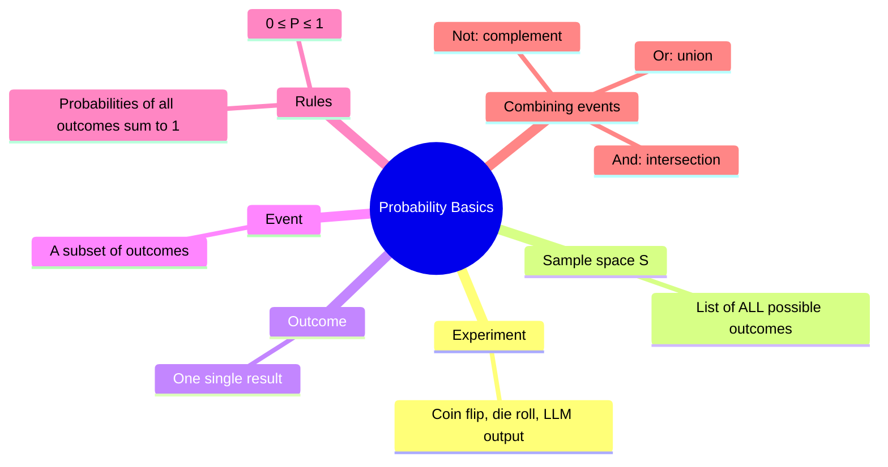
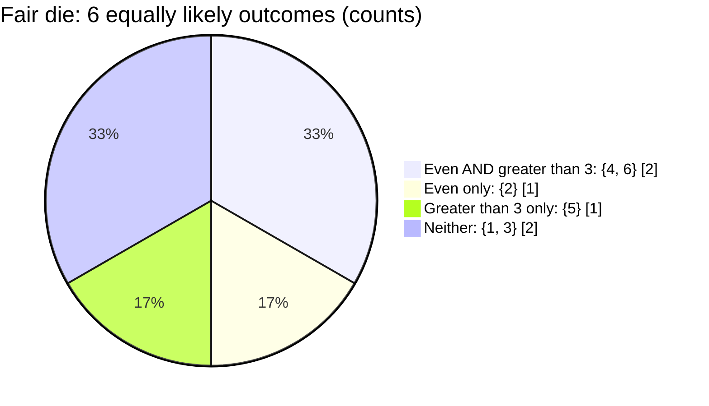
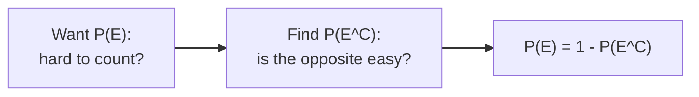
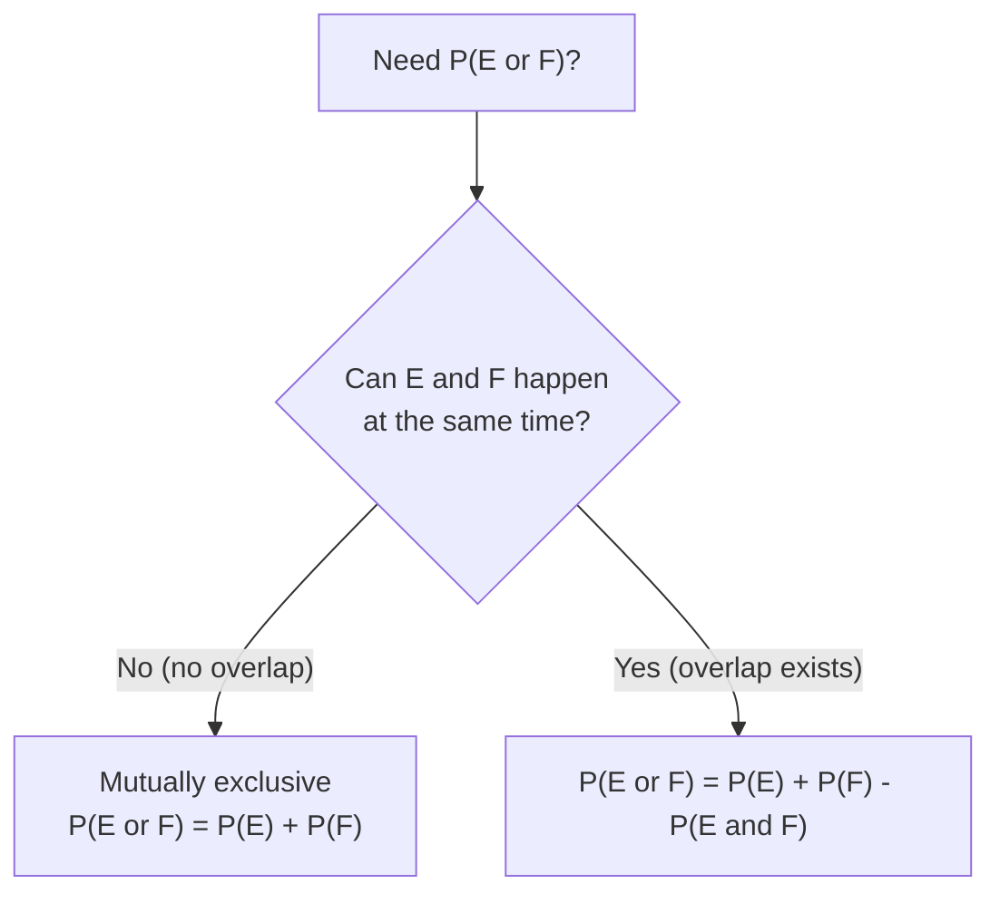
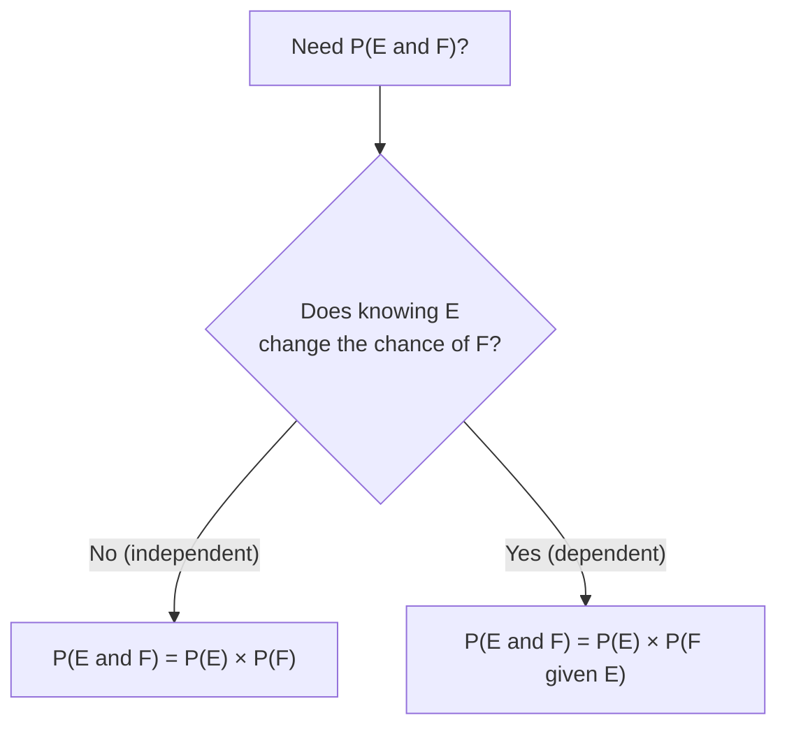
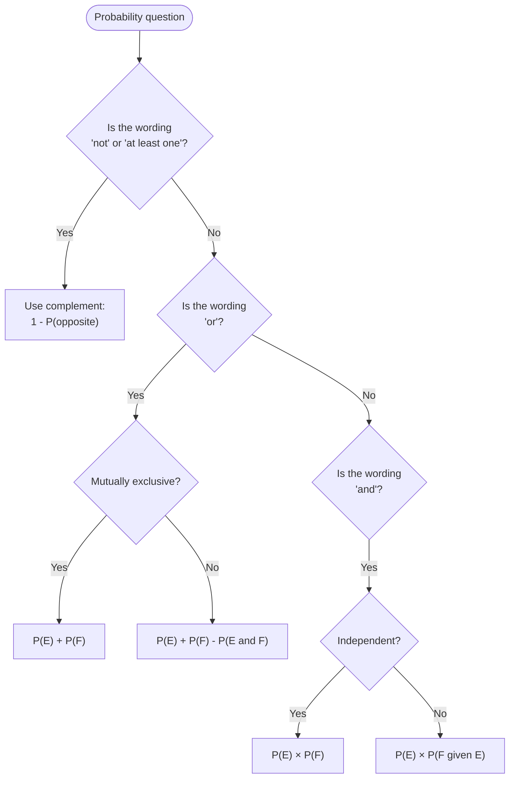

# Probability for AI: Week 1 Review
### Basic Terms, the Three Core Rules, and Practice

---

## Table of Contents

0. [Prerequisites: What You Need Before Starting](#0-prerequisites-what-you-need-before-starting)
1. [Why Probability Matters for AI](#1-why-probability-matters-for-ai)
2. [Basic Probability Terms](#2-basic-probability-terms)
3. [Running Example: Rolling a Fair Die](#3-running-example-rolling-a-fair-die)
4. [Combining Events: Not, Or, and And](#4-combining-events-not-or-and-and)
5. [Rule 1: The Complement ("Not")](#5-rule-1-the-complement-not)
6. [Rule 2: The Addition Rule ("Or")](#6-rule-2-the-addition-rule-or)
7. [Rule 3: The Multiplication Rule ("And")](#7-rule-3-the-multiplication-rule-and)
8. [Choosing the Right Rule](#8-choosing-the-right-rule)
9. [Common Mistakes to Avoid](#9-common-mistakes-to-avoid)
10. [Practice Problems: Step by Step](#10-practice-problems-step-by-step)
11. [Quick Reference Sheet](#11-quick-reference-sheet)

---

## 0. Prerequisites: What You Need Before Starting

You do not need advanced maths for this week. You do need the following basics. If any of them feel unfamiliar, spend 10 minutes on them first, because every later step depends on them.

| Topic | What to know | Example |
|---|---|---|
| **Fractions** | Add, multiply and simplify fractions | $\frac{1}{2} \times \frac{1}{3} = \frac{1}{6}$ |
| **Decimals and percentages** | Convert between them | $0.25 = 25\% = \frac{1}{4}$ |
| **Exponents** | $a^2 = a \times a$ | $0.44^2 = 0.1936$ |
| **Summation notation** | $\sum$ means "add up a list" | $\sum_{i=1}^{3} x_i = x_1 + x_2 + x_3$ |
| **Sets and Venn diagrams** | Objects inside a group, overlaps between groups | "Even numbers" and "numbers above 3" overlap at 4 and 6 |
| **Basic algebra** | Rearranging $a = b + c$ to $c = a - b$ | Used in the complement rule |

> **NOTE:** Probability is mostly careful counting plus a few simple rules. If you can add, multiply and count lists, you can follow everything in these notes.

### Set Symbols You Will See

| Symbol | Read as | Meaning in probability |
|---|---|---|
| $\cup$ | union | "or": at least one of the events happens |
| $\cap$ | intersection | "and": both events happen |
| $E^C$ or $\bar{E}$ | complement | "not E": E does not happen |
| $\emptyset$ | empty set | an impossible event (probability 0) |
| $\in$ | "is an element of" | "outcome 4 is in event E" |

---

## 1. Why Probability Matters for AI

AI models rarely give a single certain answer. Instead, they assign probabilities to possible answers and then pick one. A spam filter says "this email is 92% likely spam". A medical model says "this scan is 70% likely to show a tumour". A language model says "the next word is 'mat' with 60% probability".

To understand, evaluate and debug these systems you need to answer questions like:

- How likely is it that *either* of two things happens?
- How likely is it that *both* things happen?
- If one thing has already happened, how does that change the chance of another?

This week covers exactly those questions.

---

## 2. Basic Probability Terms

Before any formulas, you need a shared vocabulary.

| Term | Definition | Example (rolling a die) |
|---|---|---|
| **Experiment** | An action with uncertain result | Rolling a die |
| **Outcome** | One possible result of the experiment | Getting a 4 |
| **Sample space** ($S$) | The list of *all* possible outcomes | $S = \{1, 2, 3, 4, 5, 6\}$ |
| **Event** | A set of one or more outcomes we care about | "Roll an even number" $= \{2, 4, 6\}$ |
| **Probability** $P(E)$ | How likely an event is, as a number from 0 to 1 | $P(\text{even}) = \frac{3}{6} = \frac{1}{2}$ |

### The Three Basic Rules of Probability

Every probability in this course follows these three rules:

1. **Between 0 and 1:** $0 \le P(E) \le 1$. A probability of 0 means impossible, 1 means certain.
2. **Everything adds to 1:** the probabilities of all outcomes in the sample space add up to exactly 1.
3. **Equally likely outcomes:** for a fair die, each face has probability $\frac{1}{6}$. When all $n$ outcomes are equally likely, $P(E) = \frac{\text{number of outcomes in } E}{n}$.

> **NOTE:** The same rules apply to the LLM example from the slides: its five possible outputs have probabilities $0.44 + 0.20 + 0.14 + 0.13 + 0.09 = 1.00$.

### Visual Overview of the Terms



---

## 3. Running Example: Rolling a Fair Die

We will use one example throughout these notes so that every formula is grounded in something concrete.

**Sample space:** $S = \{1, 2, 3, 4, 5, 6\}$, and each outcome has probability $\frac{1}{6}$.

We define three events:

| Event | Description | Outcomes | Probability |
|---|---|---|---|
| $E$ | Roll an **even** number | $\{2, 4, 6\}$ | $P(E) = \frac{3}{6} = \frac{1}{2}$ |
| $F$ | Roll a number **greater than 3** | $\{4, 5, 6\}$ | $P(F) = \frac{3}{6} = \frac{1}{2}$ |
| $G$ | Roll a **6** | $\{6\}$ | $P(G) = \frac{1}{6}$ |

The following pie chart splits the whole sample space into the four regions that matter when $E$ and $F$ overlap. Each slice is labelled with its outcomes.



> **NOTE:** The overlap $\{4, 6\}$ is the heart of this week. It is what makes "or" and "and" tricky.

---

## 4. Combining Events: Not, Or, and And

Events can be combined in three ways. Each has its own symbol, its own English word, and its own rule.

| English word | Symbol | Meaning | Example with the die |
|---|---|---|---|
| **Not** | $E^C$ | $E$ does *not* happen | $E^C = \{1, 3, 5\}$ (odd numbers) |
| **Or** | $E \cup F$ | At least one of $E$, $F$ happens | $E \cup F = \{2, 4, 5, 6\}$ |
| **And** | $E \cap F$ | Both $E$ and $F$ happen | $E \cap F = \{4, 6\}$ |

### Venn Diagram View

```
   Sample space S (all 6 faces)
  +-------------------------------------------+
  |                                           |
  |     E (even)           F (greater than 3) |
  |   +----------+      +----------+          |
  |   |          |      |          |          |
  |   |   {2}    | {4,6}|   {5}    |          |
  |   |          +------+          |          |
  |   +----------+      +----------+          |
  |                                           |
  |   {1, 3} are in neither circle            |
  +-------------------------------------------+

  E ∩ F  = the overlap       = {4, 6}
  E ∪ F  = everything in a circle = {2, 4, 5, 6}
  E^C    = everything outside E   = {1, 3, 5}
```

> **NOTE:** When you see the word "or" in a probability question, think "union" ($\cup$). When you see "and", think "intersection" ($\cap$). When you see "not", think "complement" ($^C$).

---

## 5. Rule 1: The Complement ("Not")

### What It Says

The complement of an event $E$ is everything that is **not** $E$. Either $E$ happens or it does not, so together they cover all possibilities:

$$\boxed{P(E^C) = 1 - P(E)}$$

### Why This Matters

Some events are hard to count directly, but their opposite is easy. A common phrase is **"at least one"**. "At least one" means "one, two, three, or more", which is a long list of cases. Its complement is "none", which is usually a single case.

**Strategy:** To find "at least one", calculate $1 - P(\text{none})$.

### Worked Example: Three Coin Flips

**Question:** What is the probability of getting at least one head in three fair coin flips?

**Step 1 — List the sample space.** Each flip has 2 results, so there are $2^3 = 8$ equally likely outcomes:

HHH, HHT, HTH, HTT, THH, THT, TTH, TTT

**Step 2 — Count the direct way (for checking).** Outcomes with at least one H: all except TTT, so 7 outcomes. $P = \frac{7}{8}$.

**Step 3 — Use the complement (the smart way).** Let $E$ = "at least one head". Then $E^C$ = "no heads" = {TTT}.

$$P(E^C) = \frac{1}{8}$$

$$P(E) = 1 - P(E^C) = 1 - \frac{1}{8} = \frac{7}{8} = 0.875$$

> **Result:** Both methods agree: there is an 87.5% chance of at least one head. The complement saved you from listing seven cases.

### Visual Flow



---

## 6. Rule 2: The Addition Rule ("Or")

To find the chance that **E or F** happens, you add their probabilities. But you must check whether they overlap, because overlaps get counted twice.

### Case A: Mutually Exclusive Events (No Overlap)

Two events are **mutually exclusive** (also called **disjoint**) if they cannot both happen at the same time. In set language, $E \cap F = \emptyset$.

$$\boxed{P(E \text{ or } F) = P(E) + P(F)}$$

**Example:** Let $E$ = roll an odd number $= \{1, 3, 5\}$, and $G$ = roll a 6 $= \{6\}$. A single roll cannot be odd *and* 6, so they are mutually exclusive.

$$P(E \text{ or } G) = \frac{3}{6} + \frac{1}{6} = \frac{4}{6} = \frac{2}{3}$$

Check by listing: $E \cup G = \{1, 3, 5, 6\}$, which has 4 of 6 outcomes. ✓

### Case B: Overlapping Events

If the events *can* happen together, adding them counts the overlap twice. So we subtract it once:

$$\boxed{P(E \text{ or } F) = P(E) + P(F) - P(E \text{ and } F)}$$

**Example:** $E$ = even $= \{2, 4, 6\}$, $F$ = greater than 3 $= \{4, 5, 6\}$.

- $P(E) = \frac{1}{2}$, $P(F) = \frac{1}{2}$
- $P(E \cap F) = P(\{4, 6\}) = \frac{2}{6} = \frac{1}{3}$

$$P(E \cup F) = \frac{1}{2} + \frac{1}{2} - \frac{1}{3} = \frac{3}{6} + \frac{3}{6} - \frac{2}{6} = \frac{4}{6} = \frac{2}{3}$$

**Check by listing:** $E \cup F = \{2, 4, 5, 6\}$, 4 of 6 outcomes = $\frac{2}{3}$. ✓

> **Why subtract?** Outcomes 4 and 6 are in *both* $E$ and $F$, so adding $P(E) + P(F)$ counted them twice. Subtracting $P(E \cap F)$ removes the double count.

### Decision Diagram for the Addition Rule



---

## 7. Rule 3: The Multiplication Rule ("And")

To find the chance that **E and F** both happen, you multiply. But whether you can simply multiply depends on **independence**.

### Independence

Two events are **independent** if knowing one happened does not change the chance of the other.

- Coin flip 1 does not affect coin flip 2.
- Drawing a card *with replacement* does not affect the next draw.
- A die roll does not affect the next die roll.

Formally, $E$ and $F$ are independent if:

$$P(F \mid E) = P(F)$$

### Conditional Probability

The vertical bar $\mid$ means "given that". $P(F \mid E)$ is read as "the probability of $F$, **given** that $E$ has already happened".

It is calculated by restricting attention to the outcomes where $E$ happened:

$$\boxed{P(F \mid E) = \frac{P(E \text{ and } F)}{P(E)}}$$

**Example:** Given that the die shows an even number, what is the probability it is greater than 3?

- $P(E \cap F) = \frac{1}{3}$ and $P(E) = \frac{1}{2}$

$$P(F \mid E) = \frac{1/3}{1/2} = \frac{2}{3}$$

**Check by listing:** Given the roll is even, the possible results are $\{2, 4, 6\}$. Of these, 4 and 6 are greater than 3, so $\frac{2}{3}$. ✓

### The Multiplication Rule

Rearranging the conditional formula gives the general multiplication rule:

$$\boxed{P(E \text{ and } F) = P(E) \cdot P(F \mid E)}$$

If the events are **independent**, then $P(F \mid E) = P(F)$, so the rule simplifies to:

$$\boxed{P(E \text{ and } F) = P(E) \cdot P(F)} \qquad \text{(independent events only)}$$

### Worked Example A — Independent Events

**Question:** Let $E$ = roll an even number $= \{2, 4, 6\}$, and $D$ = roll a number at most 4 $= \{1, 2, 3, 4\}$. Are they independent?

- $P(E) = \frac{1}{2}$, $P(D) = \frac{4}{6} = \frac{2}{3}$
- $E \cap D = \{2, 4\}$, so $P(E \cap D) = \frac{2}{6} = \frac{1}{3}$

**Test:** Does $P(E) \cdot P(D) = P(E \cap D)$?

$$\frac{1}{2} \cdot \frac{2}{3} = \frac{1}{3} = P(E \cap D) \quad \checkmark$$

> **Result:** Yes, independent. Knowing the roll is even does not change the chance it is at most 4 (it stays $\frac{2}{3}$). Multiplying works.

### Worked Example B — Dependent Events (Drawing Cards Without Replacement)

**Question:** You draw two cards from a standard 52-card deck without putting the first card back. What is the probability both are aces? (There are 4 aces.)

**Step 1 — Define events.** Let $A_1$ = first card is an ace, and $A_2$ = second card is an ace.

**Step 2 — Find each piece.**

- $P(A_1) = \frac{4}{52}$
- $P(A_2 \mid A_1) = \frac{3}{51}$ (one ace is gone, and one card is gone)

**Step 3 — Multiply.**

$$P(A_1 \text{ and } A_2) = \frac{4}{52} \cdot \frac{3}{51} = \frac{12}{2652} = \frac{1}{221} \approx 0.0045$$

**Why not just $\left(\frac{4}{52}\right)^2$?** That would assume independence, giving about 0.0059. The events are *dependent* because the first draw changes the deck, so the simple square is wrong.

### Decision Diagram for the Multiplication Rule



---

## 8. Choosing the Right Rule

Most probability questions in this course reduce to picking the right rule from this table:

| Question wording | Symbol | Rule to use | Check first |
|---|---|---|---|
| "not E" | $E^C$ | $P(E^C) = 1 - P(E)$ | Is the opposite easier to count? |
| "at least one" | $E$ | $P(E) = 1 - P(\text{none})$ | Is "none" a single case? |
| "E or F" | $E \cup F$ | Addition rule | Can they overlap? |
| "E and F" | $E \cap F$ | Multiplication rule | Are they independent? |
| "F given E" | $F \mid E$ | $\frac{P(E \cap F)}{P(E)}$ | Is $P(E) > 0$? |

### Master Flowchart



---

## 9. Common Mistakes to Avoid

### Mistake 1 — Confusing "mutually exclusive" with "independent"

These are **not** the same idea.

- **Mutually exclusive:** cannot happen together. Knowing E happened tells you F definitely did *not* happen.
- **Independent:** knowing E happened tells you nothing about F.

**Key fact:** if $E$ and $F$ are mutually exclusive and both have positive probability, they are **not** independent. Knowing one happened changes the chance of the other to 0.

### Mistake 2 — Adding overlapping events without subtracting

$P(E \text{ or } F) = P(E) + P(F)$ is only true when there is no overlap. Otherwise you double count. Always ask, "Can both happen?"

### Mistake 3 — Multiplying dependent events

Multiplying $P(E) \cdot P(F)$ assumes independence. For dependent events, use $P(F \mid E)$.

### Mistake 4 — Swapping $P(F \mid E)$ and $P(E \mid F)$

These are generally different. In the die example, $P(F \mid E) = \frac{2}{3}$, but $P(E \mid F) = \frac{P(E \cap F)}{P(F)} = \frac{1/3}{1/2} = \frac{2}{3}$. Here they happen to match, which is a coincidence. Do not assume they are always equal.

> **NOTE:** When in doubt, list the outcomes. For small sample spaces, counting is the most reliable check.

---

## 10. Practice Problems: Step by Step

### Problem 1 — Die Events

> **Question:** A fair die is rolled once. Let $E$ = roll at most 2, and $F$ = roll an odd number. Find $P(E \text{ or } F)$, $P(E \text{ and } F)$, and $P(E^C)$.

**Step 1 — List the events.**

- $E = \{1, 2\}$, so $P(E) = \frac{2}{6} = \frac{1}{3}$
- $F = \{1, 3, 5\}$, so $P(F) = \frac{3}{6} = \frac{1}{2}$

**Step 2 — Intersection.** $E \cap F = \{1\}$, so $P(E \cap F) = \frac{1}{6}$.

**Step 3 — Union (addition rule with overlap).**

$$P(E \cup F) = \frac{1}{3} + \frac{1}{2} - \frac{1}{6} = \frac{2}{6} + \frac{3}{6} - \frac{1}{6} = \frac{4}{6} = \frac{2}{3}$$

**Step 4 — Complement.**

$$P(E^C) = 1 - \frac{1}{3} = \frac{2}{3}$$

**Check:** $E^C = \{3, 4, 5, 6\}$, which has 4 of 6 outcomes, so $\frac{2}{3}$. ✓

> **Answers:** $P(E \cup F) = \frac{2}{3}$, $P(E \cap F) = \frac{1}{6}$, $P(E^C) = \frac{2}{3}$

---

### Problem 2 — At Least One Head

> **Question:** A fair coin is flipped 4 times. What is the probability of getting at least one head?

**Step 1 — Recognise the phrase.** "At least one" means use the complement.

**Step 2 — Find the complement.** "No heads" means TTTT, which is one outcome out of $2^4 = 16$.

$$P(\text{no heads}) = \frac{1}{16}$$

**Step 3 — Subtract from 1.**

$$P(\text{at least one head}) = 1 - \frac{1}{16} = \frac{15}{16} = 0.9375$$

> **Answer:** $\frac{15}{16} \approx 93.75\%$

---

### Problem 3 — Consistency in an AI System (Independent Calls)

> **Question:** An AI model answers a question correctly with probability 0.8 on each independent attempt. If you ask it twice, what is the probability that:
> (a) both answers are correct, and
> (b) at least one answer is correct?

**Part (a) — Both correct (and, independent):**

$$P(\text{both correct}) = 0.8 \times 0.8 = 0.64$$

**Part (b) — At least one correct (complement):**

First find the probability that **both are wrong**. Each wrong answer has probability $1 - 0.8 = 0.2$.

$$P(\text{both wrong}) = 0.2 \times 0.2 = 0.04$$

$$P(\text{at least one correct}) = 1 - 0.04 = 0.96$$

> **Answers:** (a) 0.64, (b) 0.96
>
> **Interpretation:** Asking twice raises the chance of getting at least one correct answer from 80% to 96%. This is one reason practitioners sample several answers, but it only works when the attempts are genuinely independent.

---

## 11. Quick Reference Sheet

| Concept | Formula or definition | When to use |
|---|---|---|
| Probability range | $0 \le P(E) \le 1$ | Sanity check every answer |
| Total probability | Probabilities of all outcomes sum to 1 | Check a distribution |
| Complement | $P(E^C) = 1 - P(E)$ | "not", or "at least one" |
| Addition (no overlap) | $P(E \cup F) = P(E) + P(F)$ | "or", mutually exclusive |
| Addition (overlap) | $P(E \cup F) = P(E) + P(F) - P(E \cap F)$ | "or", can happen together |
| Conditional | $P(F \mid E) = \frac{P(E \cap F)}{P(E)}$ | "given that" |
| Multiplication (general) | $P(E \cap F) = P(E) \cdot P(F \mid E)$ | "and", always valid |
| Multiplication (independent) | $P(E \cap F) = P(E) \cdot P(F)$ | "and", only if independent |
| Independence test | $P(F \mid E) = P(F)$ | Does E change F? |

### Bridge to the Next Section

The LLM slides (slides 10–18) use exactly these rules. Running a model twice and asking "what is the chance the two outputs differ?" is a complement problem, and asking "what is the chance of at least one match?" uses the same pattern as Problem 3 above. The step-by-step LLM problem is covered in the separate notes on sampling.

---

## Try It Out!

> Suppose you draw two cards from a standard 52-card deck **without** replacement. What is the probability that **at least one** of the two cards is a heart?
>
> *Hints:*
> - *"At least one" suggests the complement.*
> - *Find P(neither card is a heart), then subtract from 1.*
> - *The first draw leaves 39 non-hearts out of 51 remaining cards. Think about whether the second draw depends on the first.*

---

*End of notes. Keep practising, and list the outcomes whenever you feel stuck. Happy learning!*
